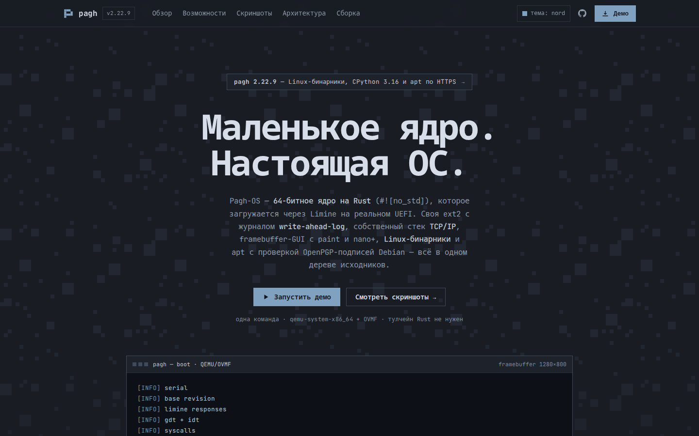

# pagh — лендинг

Статический сайт проекта [Pagh-OS](https://github.com/ccclosed/Pagh-OS): одно дерево `index.html`, `styles.css`, `script.js` и `assets/`. Без сборки и зависимостей.

**Живая версия:** https://ccclosed.github.io/pagh-os-site/



## Запустить

```sh
cd site
python3 -m http.server 8765
# http://127.0.0.1:8765/
```

## Что внутри

| файл | роль |
|---|---|
| `index.html` | вся страница: hero, обзор, установка, подсистемы, скриншоты, архитектура, безопасность, тесты, CTA, футер |
| `styles.css` | дизайн-токены и пять тем, сетки, карточки, код-блоки, адаптив |
| `script.js` | переключение тем (`T`, кнопка, `?theme=`), копирование команд, появление секций, лайтбокс скриншотов, мобильное меню |
| `assets/img/` | скриншоты и демо из `Pagh-OS/docs/` (gif пережат под веб) |
| `assets/fonts/` | JetBrains Mono и Geist, woff2 |
| `assets/pixels.svg` | пиксельный дизеринг-паттерн hero (маска, красится в цвет темы) |

## Дизайн-язык

Референс — [omarchy.org](https://omarchy.org/). Токены сняты инструментом **designlang 13.4.1** (`Manavarya09/design-extract`) **через MCP-сервер**: `extract_design` → `get_job_status` → `get_tokens` / `get_colors` / `get_typography` / `get_components` / `get_findings` / `export design-md`.

Результат лежит рядом, в `../design-ref/omarchy-mcp/`:

- `DESIGN.md` — сводка: intent, material, шкалы, компоненты, do/don't;
- `tokens.css`, `tokens.json` — W3C DTCG-токены (primitive + semantic);
- `colors.json`, `typography.json`, `components.json`, `findings.json`;
- `tailwind.css` — для совместимости.

Из них взяты сетка 1152px, шаг 4px, радиус 4px, моно-типографика (JetBrains Mono) с Geist для цитат, плоские 1px рамки, акцентные кнопки с тёмным текстом и пиксельный дизеринг.

## Темы

`nord` (по умолчанию — тёмная сторона того же набора, Nord), `amber`, `green`, `paper` (Catppuccin Latte — точное соответствие извлечённым токенам Omarchy), `synth`. Переключение: кнопка в шапке, клавиша `T`, или `?theme=paper` в URL (для QA и шеринга). Выбор хранится в `localStorage`.

## Проверка соответствия бренду

`verify_ui` (designlang MCP) сверяет страницу с `../design-ref/omarchy-mcp/DESIGN.md` на 390 / 768 / 1280 px и в тёмной схеме:

- `?theme=paper` — **pass**, 0 замечаний;
- тема по умолчанию `nord` — единственное расхождение: `color.primary` (`#81a1c1` вместо `#1e66f5`). Это осознанно: тёмная Nord-тема того же сайта, в которой Omarchy открывается по умолчанию.

## Ссылки

GitHub: <https://github.com/ccclosed/Pagh-OS> · demo bundle: <https://github.com/ccclosed/Pagh-OS/releases/tag/2.18.12-demo>